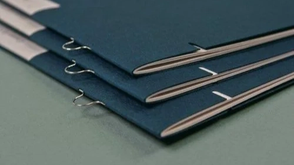
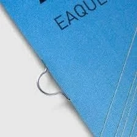

“Loop Stitch Binding Staples” & “Loop Staple Binding”

These are so funky looking… just funky lil dudes on a saddlestitch?

I’ve never seen these before. What the heck they’re kind of cool?

What they’re for:

- Bound pamphlets can be gathered into binders made specially for loop staples. The idea is that you can put them in (usually instructional or tech manuals) and them add later editions into the same binder as they become available.
- There are larger versions for bigger binds (like maps) that can be hung sort of like hangers? Apparently?
- These are done with what’s called a “Saddle Hook Stapler”

I don’t know why this is so neat to me. I guess because I’ve never seen it before. It’s kind of satisfying to look at, I guess.