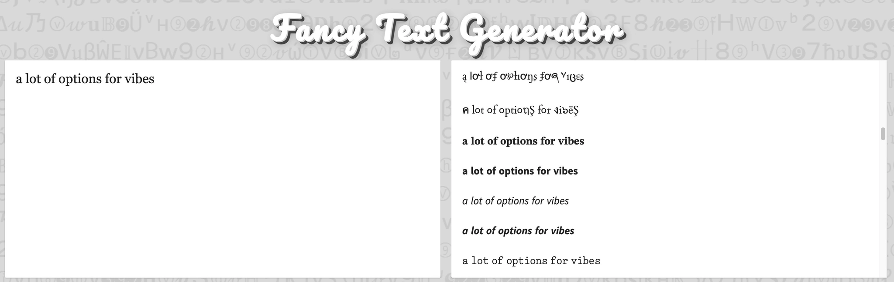
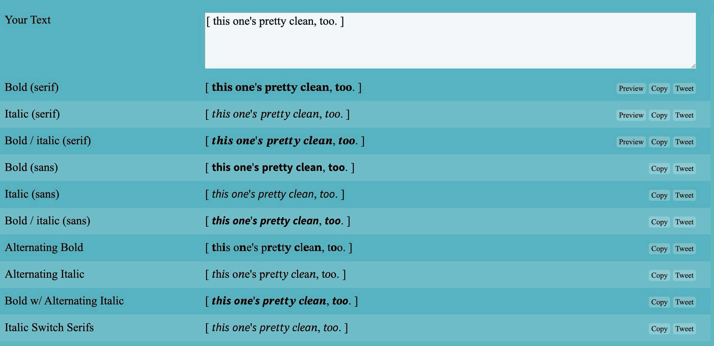
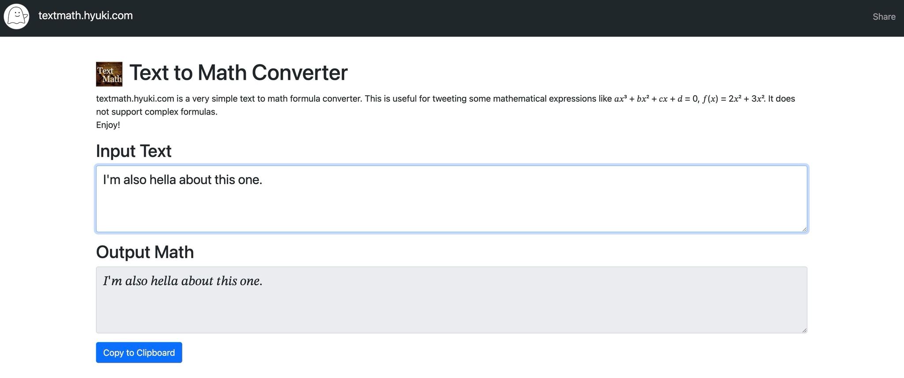
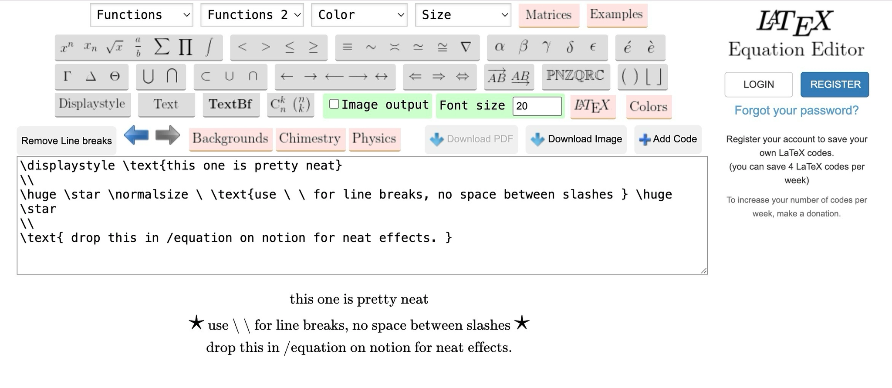

𝑰'𝒎 𝒂𝒄𝒕𝒖𝒂𝒍𝒍𝒚 𝒔𝒐 𝒊𝒏𝒕𝒐 𝒕𝒉𝒆𝒔𝒆 𝒇𝒐𝒏𝒕 𝒈𝒆𝒏𝒆𝒓𝒂𝒕𝒐𝒓𝒔. 
𝘵𝘩𝘦𝘺'𝘳𝘦 𝘮𝘰𝘳𝘦 𝘭𝘪𝘬𝘦 𝘤𝘰𝘯𝘷𝘦𝘳𝘵𝘦𝘳𝘴 𝘵𝘩𝘢𝘯 𝘨𝘦𝘯𝘦𝘳𝘢𝘵𝘰𝘳𝘴 𝘵𝘣𝘩. 

I overuse crazy font converters generators too much so I might as well share some of my favorites:

[Fancy Text Generator (𝓬𝓸𝓹𝔂 𝖆𝖓𝖉 𝓹𝓪𝓼𝓽𝓮) ― LingoJam](https://lingojam.com/FancyTextGenerator)

[Bold and Italic Text Generators - 𝐁𝐨𝐥𝐝 𝒂𝒏𝒅 𝑖𝑡𝑎𝑙𝑖𝑐𝑠 - YayText!](https://yaytext.com/bold-italic/)

[Text to Math Converter - textmath.hyuki.com](https://textmath.hyuki.com/)

[Online LaTeX Equation Editor](https://latexeditor.lagrida.com/)
